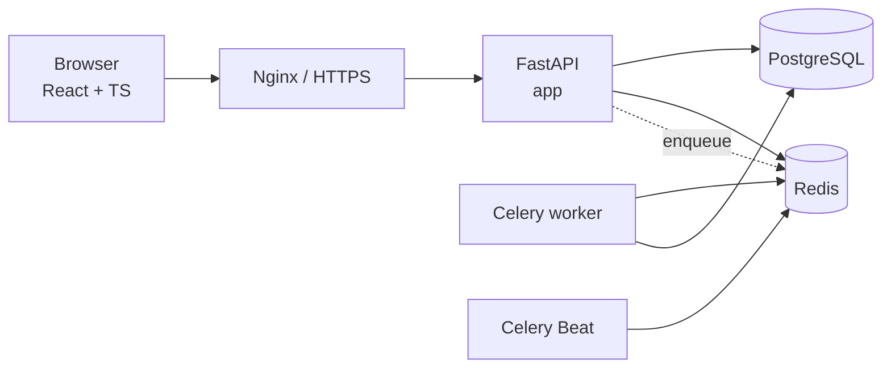

# Architecture

**Status:** Milestone 1 (foundation). Business modules are added from M2 onward.
**Related:** `docs/IMPLEMENTATION_PLAN.md`, `docs/DATABASE.md`, `docs/SCORING.md`.

---

## 1. Deployable topology (V1)



One FastAPI deployable, one worker deployment, one Beat scheduler. No
microservices, Kafka, or Kubernetes in V1.

---

## 2. Backend structure

```text
backend/app/
  main.py           application factory, exception handlers, middleware
  core/
    config.py       Pydantic Settings; production hardening checks
    context.py      request ID + tenant context vars
    tenant.py       transaction-local set_config for RLS
    middleware.py   request IDs, access logs, timing
    exceptions.py   AppError hierarchy + error envelope
    logging.py      JSON logs with request IDs
  database/
    base.py         declarative Base (Alembic target metadata)
    session.py      engine, SessionLocal, get_db, readiness probe
  api/v1/
    router.py       versioned router
    health.py       liveness + readiness
  workers/
    celery_app.py   broker/backend config, queues, routes
    tasks.py        healthcheck task (proves wiring)
```

Later milestones add `modules/<domain>/` with only the layers each domain
needs (`models`, `schemas`, `repository`, `service`, `router`).

---

## 3. Request lifecycle

```text
HTTP request
  → RequestContextMiddleware   assign/propagate X-Request-ID, start timer
  → CORS
  → router / dependency       resolve authenticated identity (M2)
  → tenant context            NEVER from client input (M2)
  → service + repository      transaction; apply_tenant(session) sets RLS var
  → response                  X-Request-ID, JSON error envelope on failure
  → access log                method, path, status, duration, request_id
```

Rules:

- Tenant identity is resolved from the authenticated session only.
- `apply_tenant()` uses `set_config(..., true)`, so it is transaction-local and
  cannot leak through the connection pool.
- Repository queries always filter by tenant; RLS is the second layer.
- Missing tenant context raises before any query.

---

## 4. Configuration

All settings come from environment variables (see `.env.example`). Two database
URLs are deliberate:

| Variable | Role | Used by |
| --- | --- | --- |
| `DATABASE_URL` | `profile_app` — restricted, no RLS bypass | API, workers |
| `MIGRATION_DATABASE_URL` | `profile_owner` — schema owner | Alembic |

Production additionally rejects `debug=true` and the default development
credentials at startup.

---

## 5. Frontend structure

```text
frontend/src/
  app/            router, providers (TanStack Query)
  components/     layout and reusable UI
  features/       auth, dashboard, (students, profiles, ... in later milestones)
  services/       typed API client
  types/          API contracts
  styles/         Tailwind entry
```

Route guards are a UX convenience only; the backend authorizes every action.

---

## 6. Boundaries to preserve

1. `integrations` must never import `scoring`.
2. `scoring` receives normalized metrics + a config document; it does not call
   connectors or read ORM models.
3. Append-only tables are insert-only for the application role.
4. Background jobs carry and validate tenant context.
5. Historical scores and rankings are never updated in place.

---

## 7. Deferred by design

- RLS policies and domain tables → M2.
- Authentication (OIDC + password fallback) → M2.
- Celery queues beyond wiring → M4.
- Monitoring stack (Prometheus/Grafana), Nginx TLS, backups → M7.
