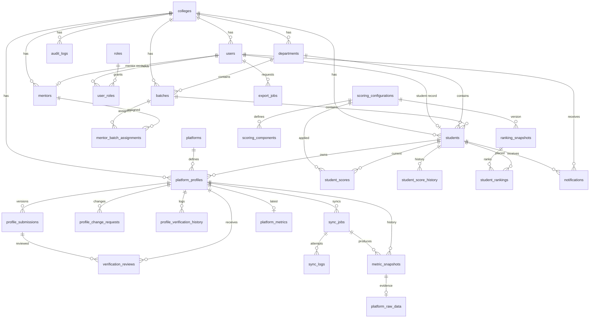

# Database Design & Tenant Isolation — Profile Analyzer V1

**Status:** M2 identity and institution tables are implemented. Tables for
platforms, profiles, metrics, scoring, rankings and placement remain proposals
for their milestones.
**Source:** `README.md` §8–§12, §15; `docs/IMPLEMENTATION_PLAN.md`.
**Decision:** PostgreSQL + SQLAlchemy 2.x + Alembic. Shared database, shared
schema, `college_id` on every tenant-owned row, RLS as defense in depth.

### Implementation status

| Migration | State |
| --- | --- |
| `0001_baseline` | Applied. Enables `pgcrypto` (`gen_random_uuid()`). |
| `0002_identity_institution` | Applied. Creates the M2 tables, constraints and indexes below. |
| `0003_rls_policies` | Applied. Enables/forces RLS on ten tables and grants the runtime role. |

The SQLAlchemy models live in `backend/app/modules/identity/models.py`,
`backend/app/modules/institution/models.py` and
`backend/app/modules/audit/models.py`. The migration sequence for later
milestones is listed in §7.

---

## 1. Conventions

| Concern | Convention |
| --- | --- |
| Primary keys | `uuid` default `gen_random_uuid()` (pgcrypto / pg 13+ `gen_random_uuid`) |
| Timestamps | `timestamptz`, always UTC; `created_at` default `now()` |
| Mutable tables | `updated_at timestamptz not null default now()` maintained by trigger |
| Tenant column | `college_id uuid not null references colleges(id)` on every tenant-owned table |
| Naming | snake_case, plural tables, `idx_` / `uq_` / `fk_` / `ck_` prefixes |
| Enums | `varchar` + named `CHECK` constraint for evolving sets; native PG enum only for truly fixed sets (avoids `ALTER TYPE` migrations) |
| Numeric scores | `numeric(5,2)` (0.00–100.00); weights `numeric(6,5)` |
| JSON | `jsonb`; never a substitute for columns that are filtered or joined on |
| Soft delete | `deleted_at timestamptz` only on institutional records; never on append-only/history tables |
| Append-only | `profile_submissions`, `verification_reviews`, `profile_verification_history`, `sync_logs`, `metric_snapshots`, `student_score_history`, `score_calculation_logs`, `ranking_snapshots`, `student_rankings`, `audit_logs` |

**Standard columns** are implied in the catalogue and not repeated per table:

```text
id uuid primary key default gen_random_uuid()
created_at timestamptz not null default now()
```

Tenant-owned tables additionally imply `college_id uuid not null` and, when
mutable, `updated_at timestamptz not null default now()`.

Every tenant-owned table also declares:

```sql
unique (id, college_id)   -- enables composite FKs from child tables
```

---

## 2. Tenant isolation model

### 2.1 Layers

| Layer | Mechanism |
| --- | --- |
| Request identity | Session/token → trusted `user_id`, `college_id`, roles. Client-supplied `college_id` is ignored. |
| Application scope | Repository base query always filters `college_id = context.college_id` |
| Database RLS | `ENABLE` + `FORCE ROW LEVEL SECURITY`; policies compare `college_id` to `app.current_college_id` |
| Structural | Composite FKs prevent rows from referencing another tenant's rows |
| Background jobs | Job payload carries `college_id`; worker sets context and validates it exists before any query; missing context fails the task |
| Cache | Key prefix `t:{college_id}:` |
| Exports/files | Path prefix `t/{college_id}/...`; export job rows are tenant-scoped |

### 2.2 Session variable

Set inside the same transaction as the queries, never at connection scope
(connection pooling would leak context):

```sql
-- at transaction start
SELECT set_config('app.current_college_id', :college_id, true);  -- true = LOCAL
```

Policy template applied to every tenant-owned table:

```sql
ALTER TABLE <table> ENABLE ROW LEVEL SECURITY;
ALTER TABLE <table> FORCE ROW LEVEL SECURITY;

CREATE POLICY <table>_tenant_isolation ON <table>
  USING (
    college_id = nullif(current_setting('app.current_college_id', true), '')::uuid
  )
  WITH CHECK (
    college_id = nullif(current_setting('app.current_college_id', true), '')::uuid
  );
```

`nullif(...,'')` means a missing setting yields `NULL`, which matches nothing —
fail closed.

### 2.3 Database roles

| Role | Purpose | Rights |
| --- | --- | --- |
| `profile_owner` | Migration/DDL only | Owns schema, never used by the app |
| `profile_app` | API and workers | M2 grants below; **no** `BYPASSRLS`; not the table owner |
| `profile_readonly` | Reporting/ops | `SELECT` only (future) |

M2 grants (`0003_rls_policies`):

```sql
GRANT SELECT, INSERT, UPDATE, DELETE ON
  users, user_sessions, user_roles, departments, batches,
  students, mentors, mentor_batch_assignments
TO profile_app;

GRANT SELECT, INSERT ON audit_logs TO profile_app;
GRANT SELECT ON roles TO profile_app;
GRANT SELECT, INSERT, UPDATE ON colleges TO profile_app;

REVOKE UPDATE, DELETE, TRUNCATE ON audit_logs FROM profile_app;
REVOKE UPDATE, DELETE, TRUNCATE ON roles FROM profile_app;
REVOKE DELETE, TRUNCATE ON colleges FROM profile_app;
```

Because the app role is not the table owner, RLS applies normally. `FORCE` is
still enabled so a future ownership change cannot silently bypass it. The grant
block is conditional on `profile_app` existing; Compose and CI bootstrap the
role before migrations run.

### 2.4 System / cross-tenant operations

Platform super-administration is the only implemented cross-tenant path:

- A separate `app.is_system = 'true'` setting is honoured by the `colleges`
  policy only. It is used for tenant provisioning and the pre-login college-code
  lookup.
- No `users`, student, mentor or audit policy honours the system flag. Platform
  super admins therefore cannot browse another tenant's student data; they
  switch tenant context like every other authenticated request.
- Every system operation records an `audit_logs` row (`actor_user_id` may be
  `NULL` for platform actions).
- FR-08/§16: super admins do **not** get unrestricted student-data access.

### 2.5 Structural protections

Composite parent keys and child FKs:

```sql
-- parent
alter table departments add constraint uq_departments_id_college unique (id, college_id);

-- child
alter table batches
  add constraint fk_batches_department
  foreign key (department_id, college_id)
  references departments (id, college_id);
```

Implemented in M2: `batches→departments`, `students→users/departments/batches`,
`mentors→users/departments`, `mentor_batch_assignments→mentors/batches/users`,
`user_sessions→users`, `user_roles→users/roles`, `audit_logs→users/colleges`.
The same pattern applies to profile, metric, score and ranking child tables in
later milestones.

### 2.6 Scoped uniqueness

| Constraint | Definition |
| --- | --- |
| `uq_students_register` | `(college_id, lower(register_number))` |
| `uq_users_email` | `(college_id, lower(institutional_email))` |
| `uq_platform_profiles_active_claim` | `(college_id, platform_id, normalized_username)` **partial** `WHERE verification_status IN ('PENDING_REVIEW','APPROVED','SUSPENDED')` *(M3)* |
| `uq_departments_code` | `(college_id, code)` |
| `uq_batches_name` | `(college_id, department_id, name)` |
| `uq_mentor_employee` | `(college_id, employee_code)` |
| `uq_users_oidc_identity` | `(oidc_issuer, oidc_subject)` **partial** where both are not null |

The partial unique index matters: a rejected or draft profile must not block a
corrected resubmission with the same username.

**Global account ownership** is *not* enforced in V1 (decision D3). If needed
later, add `platform_account_claims(platform_id, normalized_username)` as a
separate global registry with its own claim/release audit. Tenant-scoped
uniqueness must never be presented as global proof of ownership.

### 2.7 Query rules (enforced in review)

1. No raw `session.execute` in routers; repositories take a tenant-scoped context.
2. Any endpoint touching multiple modules opens one transaction with one tenant context.
3. Bulk imports run per-tenant and validate every row's `college_id` against context.
4. Cross-tenant aggregates are impossible without the system context.
5. Cross-tenant access tests are mandatory for every new tenant-owned table.

---

## 3. ERD (core relationships)



---

## 4. Table catalogue

### 4.1 Institution and identity

#### `colleges` (global tenant registry)
| Column | Type | Notes |
| --- | --- | --- |
| name | varchar(200) | not null |
| short_code | varchar(32) | unique, not null |
| domain | varchar(255) | institutional email domain(s), unique |
| status | varchar(20) | `ACTIVE`, `SUSPENDED`, `PROVISIONING` |
| timezone | varchar(64) | default `Asia/Kolkata` |
| settings | jsonb | tenant defaults; not authoritative for policy |
| deleted_at | timestamptz | soft delete |

RLS on `colleges`: a tenant sees only its own row; system context sees all.

#### `users`
| Column | Type | Notes |
| --- | --- | --- |
| college_id | uuid | not null |
| institutional_email | varchar(320) | not null |
| display_name | varchar(200) | not null |
| password_hash | text | null when OIDC-only (Argon2id) |
| oidc_issuer | text | null |
| oidc_subject | text | null |
| status | varchar(20) | `INVITED`,`ACTIVE`,`SUSPENDED`,`GRADUATED`,`DEACTIVATED` |
| failed_login_count | int | default 0 |
| locked_until | timestamptz | null |
| last_login_at | timestamptz | null |
| deleted_at | timestamptz | soft delete |

Constraints: `unique (college_id, lower(institutional_email))`,
`unique (oidc_issuer, oidc_subject)` (partial where both not null),
`unique (id, college_id)`.

#### `user_sessions` *(addition beyond §9 — required by the password fallback)*
| Column | Type | Notes |
| --- | --- | --- |
| college_id, user_id | uuid | not null |
| token_hash | bytea | SHA-256 of the signed session JWT, unique |
| issued_at, expires_at, revoked_at | timestamptz | |
| ip_address | inet | optional, minimized; unparseable values are discarded |
| user_agent | text | optional, minimized (truncated to 512 chars) |

The JWT carries `sub` (user), `col` (college) and `sid` (this row). Resolving a
session requires a valid signature **and** a non-revoked, unexpired row whose
hash matches the presented token. `user_sessions` is tenant-owned and protected
by RLS.

#### `roles` (global)
`code` unique (`STUDENT`, `MENTOR`, `PLACEMENT_COORDINATOR`, `COLLEGE_ADMIN`,
`SUPER_ADMIN`), `name`, `description`, `is_assignable`.

#### `user_roles`
`college_id`, `user_id`, `role_id`, `granted_by` (nullable), `granted_at`,
`revoked_at` (nullable). `unique (college_id, user_id, role_id)` partial
`WHERE revoked_at IS NULL`.

#### `departments`
`college_id`, `code varchar(32)`, `name varchar(200)`, `status`, `deleted_at`.
`unique (college_id, code)`, `unique (id, college_id)`.

#### `batches`
`college_id`, `department_id`, `name varchar(100)`, `start_year int`,
`end_year int`, `status`, `deleted_at`.
`unique (college_id, department_id, name)`, `check (end_year >= start_year)`,
`fk (department_id, college_id) → departments`.

#### `students`
| Column | Type | Notes |
| --- | --- | --- |
| college_id, user_id | uuid | not null |
| register_number | varchar(64) | not null |
| department_id, batch_id | uuid | not null |
| admission_year | int | |
| current_year | int | nullable |
| status | varchar(20) | `ACTIVE`,`GRADUATED`,`SUSPENDED`,`INACTIVE` |
| profile_completeness | numeric(5,2) | optional cached view, never authoritative |
| deleted_at | timestamptz | soft delete |

Constraints: `unique (college_id, lower(register_number))`,
`unique (college_id, user_id)`, composite FKs to users/departments/batches.

#### `mentors`
`college_id`, `user_id`, `employee_code`, `department_id` (nullable), `status`,
`deleted_at`. `unique (college_id, employee_code)`, `unique (college_id, user_id)`.

#### `mentor_batch_assignments`
`college_id`, `mentor_id`, `batch_id`, `assigned_by`, `assigned_at`,
`revoked_at`, `revoked_by`.
`unique (college_id, mentor_id, batch_id) WHERE revoked_at IS NULL`.
Composite FKs to `mentors(id, college_id)` and `batches(id, college_id)`.

This table is the basis for mentor authorization (FR-21): a mentor may review
only students whose `(department_id, batch_id)` is covered by an active
assignment. The check is enforced in `core/permissions.py` **and** covered by
tests; it is not encoded in RLS because RLS is tenant-level, not batch-level.

### 4.2 Platforms, profiles, verification

#### `platforms` (global registry)
`code` unique (`codeforces`,`github`,`leetcode`), `name`,
`access_strategy varchar(30)` (`OFFICIAL_API`, `APPROVED_API`, `MANUAL_EVIDENCE`),
`base_url`, `metric_schema_version`, `is_active`, `sync_interval_minutes` (nullable).

#### `platform_profiles`
| Column | Type | Notes |
| --- | --- | --- |
| college_id, student_id | uuid | not null |
| platform_id | uuid | not null |
| username | varchar(200) | as submitted |
| normalized_username | varchar(200) | lowercase/trimmed canonical form |
| profile_url | text | validated per platform |
| verification_status | varchar(20) | `DRAFT`,`PENDING_REVIEW`,`APPROVED`,`REJECTED`,`SUSPENDED` |
| sync_status | varchar(20) | `NEVER_SYNCED`,`QUEUED`,`SUCCESS`,`FAILED`,`RETRY_PENDING` |
| evaluation_status | varchar(20) | `PENDING`,`ELIGIBLE`,`PROVISIONAL`,`INELIGIBLE` |
| current_submission_id | uuid | nullable FK to submissions |
| approved_at, approved_by | | |
| suspended_at, suspended_reason | | |
| last_synced_at | timestamptz | |

The three statuses are deliberately separate (README §10). A sync failure never
changes `verification_status`.

Constraints: partial unique active claim (§2.6), composite FK to students,
`check (verification_status in (...))`.

#### `profile_submissions`
`college_id`, `platform_profile_id`, `version int`, `submitted_url`,
`submitted_username`, `submitted_by`, `submitted_at`, `supersedes_id`.
`unique (platform_profile_id, version)`. Append-only.

#### `verification_reviews`
`college_id`, `platform_profile_id`, `submission_id`, `reviewer_id`,
`decision varchar(10)` (`APPROVE`,`REJECT`,`SUSPEND`), `reason text`,
`notes text`, `decided_at`, `correlation_id uuid`.
`check (decision <> 'REJECT' OR length(trim(reason)) >= 10)`. Append-only.

#### `profile_change_requests`
`college_id`, `platform_profile_id`, `requested_by`, `requested_changes jsonb`,
`reason text`, `status varchar(12)` (`PENDING`,`APPROVED`,`REJECTED`,`CANCELLED`),
`decided_by`, `decided_at`, `decision_reason`, `applied_submission_id`.

#### `profile_verification_history`
Immutable event log: `college_id`, `platform_profile_id`,
`event_type varchar(40)`, `actor_user_id`, `previous_state`, `new_state`,
`reason`, `submission_id`, `correlation_id`, `occurred_at`, `metadata jsonb`.
No `updated_at`; no UPDATE/DELETE grants.

### 4.3 Metrics and synchronization

#### `sync_jobs`
| Column | Type | Notes |
| --- | --- | --- |
| college_id, platform_profile_id | uuid | not null |
| job_type | varchar(20) | `SCHEDULED`,`MANUAL`,`RETRY` |
| status | varchar(20) | `QUEUED`,`PROCESSING`,`SUCCESS`,`FAILED`,`RETRY_PENDING` |
| attempt_count, max_attempts | int | default 0 / 5 |
| idempotency_key | varchar(200) | unique per profile+window |
| scheduled_at, started_at, finished_at | timestamptz | |
| requested_by | uuid | nullable |
| last_error_code, last_error_message | | |
| correlation_id | uuid | |

Index: `(college_id, status, scheduled_at)`, `(platform_profile_id, created_at desc)`.
Unique: `idempotency_key`.

#### `sync_logs`
`college_id`, `sync_job_id`, `attempt_number`, `connector_code`,
`http_status int`, `duration_ms int`, `outcome`, `error_code`,
`error_detail text` (redacted), `started_at`, `finished_at`. Append-only.

#### `platform_metrics` (latest snapshot pointer)
`college_id`, `platform_profile_id` (unique), `sync_job_id`, `metrics jsonb`,
`source varchar(30)`, `schema_version`, `captured_at`. Upsert per profile.

#### `metric_snapshots`
`college_id`, `platform_profile_id`, `sync_job_id`, `metrics jsonb`,
`source`, `schema_version`, `captured_at`, `content_hash char(64)`.
`unique (platform_profile_id, source, content_hash)` to suppress duplicate
observations. Append-only. Index `(platform_profile_id, captured_at desc)`.

#### `platform_raw_data` (optional, minimized)
`college_id`, `platform_profile_id`, `metric_snapshot_id`, `raw_payload jsonb`,
`fetched_at`, `retention_expires_at`. Append-only; purge job deletes expired
rows (the only DELETE allowed, via a dedicated role/function).

### 4.4 Scoring and ranking

#### `scoring_configurations`
| Column | Type | Notes |
| --- | --- | --- |
| college_id | uuid | **nullable** = platform default template |
| version | int | monotonic per college |
| name | varchar(120) | |
| status | varchar(12) | `DRAFT`,`ACTIVE`,`RETIRED` |
| algorithm_version | varchar(20) | scoring engine version |
| config | jsonb | weights, curves, thresholds, coverage policy |
| effective_from, effective_to | timestamptz | |
| created_by, approved_by | uuid | |
| approved_at | timestamptz | |

Unique: `(college_id, version)` (partial indexes for NULL and non-NULL).
Only one `ACTIVE` per college at a time (partial unique index).

#### `scoring_components`
`college_id`, `scoring_configuration_id`, `component_code`, `parent_code`
(nullable, for platform→metric hierarchy), `dimension` (`CODING`,`DEVELOPMENT`),
`platform_id` (nullable), `weight numeric(6,5)`, `normalization jsonb`,
`is_required bool`, `caps jsonb`, `sort_order int`.
`unique (scoring_configuration_id, component_code)`.

Validation in the service layer: weights sum to 1.00000 within each parent
group; `is_required` components define the coverage denominator.

#### `student_scores` (current)
| Column | Type | Notes |
| --- | --- | --- |
| college_id, student_id | uuid | not null |
| scoring_configuration_id | uuid | not null |
| coding_score, development_score, combined_score | numeric(5,2) | 0–100 |
| coverage | numeric(5,2) | 0–100 |
| eligibility_status | varchar(12) | `ELIGIBLE`,`PROVISIONAL`,`INELIGIBLE` |
| breakdown | jsonb | per-component inputs, normalized values, weights |
| metric_snapshot_ids | uuid[] | evidence references |
| calculation_fingerprint | char(64) | hash of inputs (§SCORING) |
| calculated_at | timestamptz | |

Partial unique: `(college_id, student_id) WHERE is_current` — implemented as a
boolean `is_current` column, or a single row per student with history moved to
`student_score_history`.

#### `student_score_history`
Full copy of the score fields plus `source_score_id`, `superseded_at`.
Append-only.

#### `score_calculation_logs`
`college_id`, `student_id`, `scoring_configuration_id`, `status`,
`input_summary jsonb`, `output_summary jsonb`, `error_detail`, `duration_ms`,
`correlation_id`, `calculated_at`. Append-only; diagnostics only.

#### `ranking_snapshots`
`college_id`, `scope varchar(12)` (`COLLEGE`,`DEPARTMENT`,`BATCH`),
`scope_id uuid` (null for college), `scoring_configuration_id`,
`filter_criteria jsonb`, `algorithm_version`, `generated_at`,
`metric_cutoff_at`, `student_count int`, `status`.
Index `(college_id, scope, scope_id, generated_at desc)`. Append-only.

#### `student_rankings`
`college_id`, `ranking_snapshot_id`, `student_id`, `rank_position int`,
`combined_score`, `coding_score`, `development_score`, `coverage`,
`eligibility_status`, `breakdown_ref uuid`.
`unique (ranking_snapshot_id, student_id)`.
Ties share `rank_position` (competition ranking); no unique on rank.

### 4.5 Administration

#### `audit_logs`
Implemented shape: `college_id uuid not null`, `actor_user_id uuid` (nullable),
`action varchar(100)`, `entity_type varchar(100)`, `entity_id uuid`,
`details jsonb` (default `{}`), `request_id varchar(128)`, `occurred_at`.
Append-only. Index `(college_id, occurred_at desc)`.

M2 actions: `college.created`, `department.created`, `department.updated`,
`batch.created`, `mentor.created`, `mentor.assigned`, `user.status_changed`,
`students.imported`, `student.self_updated`. The runtime role has only
`SELECT, INSERT` on this table. A proposed `before`/`after` split and IP/user
agent columns can be added in a later migration if required; they are not part
of the current schema.

#### `notifications`
`college_id`, `user_id`, `type varchar(60)`, `title`, `body`, `payload jsonb`,
`read_at`, `expires_at`. Index `(user_id, read_at, created_at desc)`.

#### `export_jobs`
`college_id`, `requested_by`, `export_type`, `criteria jsonb`, `status`,
`storage_path text` (must start `t/{college_id}/`), `row_count`, `error_detail`,
`completed_at`, `expires_at`.

#### `system_settings`
`college_id`, `key`, `value jsonb`, `updated_by`. `unique (college_id, key)`.

---

## 5. Indexes (initial set)

Beyond PK/unique/composite-FK indexes:

| Table | Index |
| --- | --- |
| `users` | `(college_id, status)`, `(oidc_issuer, oidc_subject)` |
| `students` | `(college_id, department_id, batch_id)`, `(college_id, status)` |
| `mentor_batch_assignments` | `(college_id, batch_id) WHERE revoked_at IS NULL` |
| `platform_profiles` | `(college_id, verification_status)`, `(college_id, sync_status)`, `(student_id)` |
| `profile_submissions` | `(platform_profile_id, version desc)` |
| `verification_reviews` | `(college_id, reviewer_id, decided_at desc)` |
| `sync_jobs` | `(college_id, status, scheduled_at)`, `(platform_profile_id, created_at desc)` |
| `metric_snapshots` | `(platform_profile_id, captured_at desc)`, `(college_id, captured_at)` |
| `student_scores` | `(college_id, combined_score desc)` |
| `student_rankings` | `(ranking_snapshot_id, rank_position)` |
| `audit_logs` | `(college_id, occurred_at desc)` |
| `notifications` | `(user_id, read_at)` |

Partitioning of `metric_snapshots`, `student_rankings`, and `audit_logs` is
**deferred** until measured volume warrants it (README §9).

---

## 6. Append-only enforcement

Current M2 grant:

```sql
GRANT SELECT, INSERT ON audit_logs TO profile_app;
REVOKE UPDATE, DELETE, TRUNCATE ON audit_logs FROM profile_app;
REVOKE UPDATE, DELETE, TRUNCATE ON roles FROM profile_app;
```

Integration tests assert that `profile_app` can insert and read audit rows but
cannot update or delete them, and cannot modify the role catalogue.

The same `SELECT, INSERT` pattern will be applied to the later append-only
tables:

```sql
GRANT SELECT, INSERT ON
  profile_submissions, verification_reviews, profile_verification_history,
  sync_logs, metric_snapshots, student_score_history, score_calculation_logs,
  ranking_snapshots, student_rankings
TO profile_app;
-- deliberately no UPDATE / DELETE
```

Optional defense in depth: a trigger raising an exception on UPDATE/DELETE for
these tables. Retention purges (e.g. `platform_raw_data`) run as a separate
function owned by `profile_owner`, never by `profile_app`.

---

## 7. Migration order (Alembic)

Implemented:

1. `0001_baseline` — `pgcrypto` (`gen_random_uuid()`).
2. `0002_identity_institution` — colleges, users, roles, user_roles,
   user_sessions, departments, batches, students, mentors,
   mentor_batch_assignments, audit_logs; reference roles.
3. `0003_rls_policies` — enable/force RLS, tenant policies, the narrow
   `colleges` system policy, and `profile_app` grants.

Proposed for later milestones (numbering will follow the implemented history):

4. platforms, platform_profiles, submissions, reviews, change requests,
   verification history.
5. sync_jobs, sync_logs, platform_metrics, metric_snapshots, platform_raw_data.
6. scoring configurations, components, scores, history, calculation logs.
7. ranking snapshots, student rankings.
8. notifications, export jobs, settings.
9. RLS + grants for each new tenant-owned table (kept separate so policies are
   reviewable in isolation).
10. Idempotent reference seeds (platforms, scoring template); no student data.

Each migration must pass on an empty database **and** on a seeded database, and
must be reversible (`downgrade`) or explicitly documented as irreversible.

---

## 8. Verification tests

Implemented in M2 (`backend/tests/integration/test_rls.py`,
`test_rbac.py`, `test_import.py`):

| Test | Type | Status |
| --- | --- | --- |
| Queries with no `app.current_college_id` return zero rows (fail-closed) | integration | ✅ |
| Setting context to college B never returns college A rows | integration | ✅ |
| Cross-tenant `INSERT` is rejected by `WITH CHECK` | integration | ✅ |
| Duplicate `register_number` in same college fails; different college succeeds | integration | ✅ |
| App role cannot `UPDATE`/`DELETE` an audit row | integration | ✅ |
| App role cannot modify the `roles` catalogue | integration | ✅ |
| Tenant context is restored after a commit (no leaked context) | integration | ✅ |
| `app.is_system` only widens the `colleges` policy | unit + integration | ✅ |

Planned for later milestones:

| Test | Type |
| --- | --- |
| `students.department_id` from another college is rejected by composite FK | integration |
| Worker task without tenant context raises before querying | integration |
| Approving a profile twice is idempotent / blocked | workflow |
| `metric_snapshots` duplicate content hash is suppressed | integration |
| `scoring_configurations` cannot have two ACTIVE rows per college | DB test |
| Historical ranking rows unchanged after a new config activates | integration |

---

## 9. Open decisions

Resolved in M2:

- **D3** global platform-account uniqueness → deferred; tenant-scoped only
  (`UNIQUE (college_id, email)`).
- **D9** batch semantics → stored as both `start_year` and `end_year`.
- Tenant key representation → UUID FK everywhere (no `citext` college id).
- `audit_logs` shape → single `details jsonb` column instead of
  `before`/`after`; revisit only if a workflow needs structured diffing.

Still open:

- Whether `platform_raw_data` is retained at all in V1 (privacy minimization
  suggests keeping it disabled by default).
- Partitioning thresholds for `metric_snapshots` / `student_rankings` /
  `audit_logs` (deferred until measured volume warrants it).
- Whether to add a `BEFORE UPDATE/DELETE` trigger as defense in depth on top of
  the grant-based append-only enforcement.
